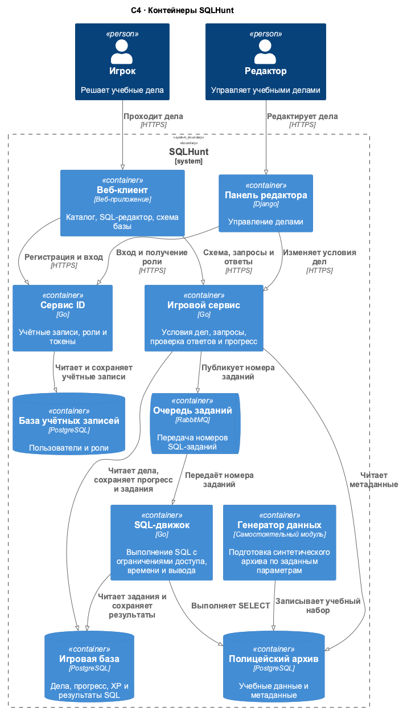
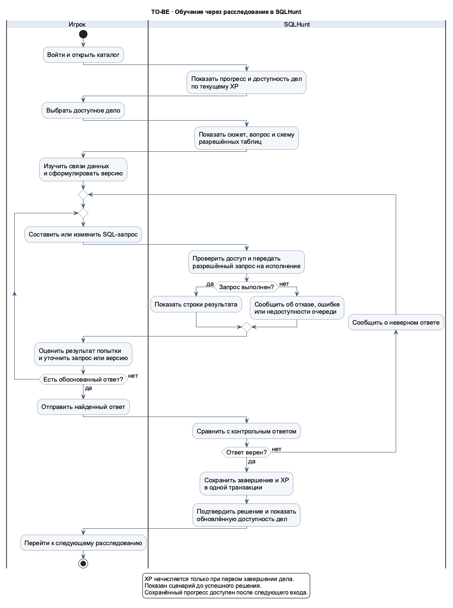

# ЛР 3 — проектирование

**Тема ВКР:** Разработка веб-платформы SQLHunt для изучения языка SQL на основе интерактивных детективных задач

**Авторы:** Якшин Артемий, Преображенский Артемий

**Вклад участников:**

- **Якшин Артемий** — проектирование клиентской части: каталога дел, редактора запросов, визуализатора схемы базы данных и взаимодействия пользователя с платформой.
- **Преображенский Артемий** — проектирование серверной части: модели данных, генератора, аутентификации, выполнения и проверки запросов.
- **Совместно** — формирование требований, выбор нотаций, согласование моделей и описание перехода от существующего процесса обучения к SQLHunt.

## 1. Предметная область и требования

### Описание предметной области

SQLHunt — браузерная игра для изучения SQL на основе интерактивных детективных задач. Пользователь выступает в роли следователя и раскрывает дела, исследуя учебную базу данных «Полицейский архив». В ней хранятся сведения о происшествиях, людях, подозреваемых, показаниях, алиби, местах преступлений, уликах и обвинениях.

При первом входе в каталог игрок получает профиль с нулевым опытом. Стартовое дело доступно без опыта. Каждое дело содержит сюжет, вопрос, награду, порог опыта и список доступных таблиц. Игрок изучает интерактивную схему базы данных, формулирует версии и проверяет их с помощью SELECT-запросов. Промежуточные результаты запросов помогают сопоставить улики, показания и сведения о подозреваемых.

SQL-запрос и ответ на вопрос дела являются разными действиями. Результат запроса помогает игроку провести расследование, а найденный ответ отправляется на отдельную проверку. При первом правильном ответе дело получает статус «завершено», игроку начисляется опыт, а в каталоге открываются следующие дела. Сложность последовательно возрастает от простых выборок и фильтрации до соединений, агрегатных функций, подзапросов, оконных функций и общих табличных выражений.

Платформа включает веб-клиент, сервис аутентификации и авторизации на Go, игровой сервис на Go, SQL-движок на Go, административную панель Django и модуль генерации синтетических данных. Служебные и учебные данные хранятся в PostgreSQL. Административная панель предназначена для управления делами, а генератор создаёт связанные фоновые и сюжетные записи «Полицейского архива».

В системе предусмотрены три роли:

- **гость** регистрируется и входит в систему;
- **игрок** выбирает дела, выполняет запросы, отправляет ответы и получает опыт;
- **редактор** создаёт и изменяет учебные дела через административную панель.

### Функциональные требования

Таблица 1 — Функциональные требования к SQLHunt

| ID | Требование | Способ проверки |
|---|---|---|
| FR-01 | Пользователь регистрируется и входит через сервис аутентификации и авторизации на Go. После повторного входа ему доступен собственный профиль. | Зарегистрировать пользователя, завершить сеанс и войти повторно. Проверить сохранение профиля и отказ при неверном пароле. |
| FR-02 | Игрок видит каталог дел, статус их прохождения и доступность по накопленному опыту. Для доступного дела отображаются сюжет и вопрос. | Сравнить каталог до и после начисления опыта. Проверить отказ при попытке открыть недоступное дело прямым запросом. |
| FR-03 | Для выбранного дела отображается интерактивная схема разрешённых таблиц с названиями, полями, типами данных, описаниями и связями. | Открыть дела с разными наборами таблиц, сверить схему с метаданными PostgreSQL, проверить перемещение узлов и масштабирование. |
| FR-04 | Игрок вручную составляет SELECT-запрос, после чего SQL-движок асинхронно выполняет его и возвращает колонки и строки результата. | Выполнить выборку и запрос с JOIN на контрольном наборе данных, сверить результат и проверить отображение состояния выполнения. |
| FR-05 | Игрок отдельно отправляет найденный ответ на вопрос дела, а система сравнивает его с контрольным ответом. | Отправить неверный и верный ответы, проверить разные результаты обработки и возможность продолжить расследование после ошибки. |
| FR-06 | При первом правильном ответе система сохраняет завершение дела и однократно начисляет награду в XP. Прогресс сохраняется между сеансами. | Завершить дело, войти повторно и проверить профиль. Повторно отправить правильный ответ и убедиться, что XP не начисляется второй раз. |
| FR-07 | При отклонении запроса, ошибке SQL, превышении лимита времени, недоступности очереди или неверном ответе игрок получает сообщение на русском языке и может повторить попытку в том же деле. | Вызвать каждый вид ошибки и проверить сообщение. После восстановления очереди или исправления запроса либо ответа повторить попытку и проверить, что прогресс сохранён. |
| FR-08 | Редактор управляет делами через административную панель Django: задаёт сюжет, вопрос, контрольный ответ, список таблиц, порог и награду XP. | Создать и изменить дело под ролью редактора, затем проверить согласованное отображение данных в игровом клиенте. |
| FR-09 | Генератор создаёт синтетические фоновые и сюжетные записи «Полицейского архива» с заданным объёмом данных. | Сгенерировать контрольный набор, проверить количество записей, внешние ключи и результат контрольного запроса для дела. |

### Нефункциональные требования

Таблица 2 — Нефункциональные требования к SQLHunt

| ID | Требование | Способ проверки |
|---|---|---|
| NFR-01 | Для доступа к профилю, делам и результатам запросов система проверяет личность пользователя. Доступ к делу ограничен порогом XP, к результату — владельцем задания, к административной панели — ролью редактора. | Проверить отказ гостю, игроку с недостаточным XP, игроку при обращении к панели редактора и пользователю при запросе чужого результата. |
| NFR-02 | Пользовательские запросы выполняются изолированно, только для разрешённых таблиц учебной базы. Разрешён только SELECT; служебные и исходные учебные данные не должны изменяться. | Отправить запрос к запрещённой таблице и команды изменения данных, затем проверить отказ и сохранность баз. |
| NFR-03 | На выполнение SQL в учебной базе отводится до 3 секунд без учёта ожидания в очереди. Результат содержит не более 1 000 строк. | Выполнить долгий запрос и запрос с результатом более 1 000 строк, проверить остановку по времени и признак усечения результата. |
| NFR-04 | Завершение дела и начисление опыта выполняются атомарно. Параллельные и повторные правильные ответы дают не более одной награды. | Одновременно отправить два правильных ответа и проверить одну запись завершения и однократное увеличение XP. |
| NFR-05 | При одинаковых параметрах, начальном значении генератора и версиях справочников формируется одинаковый набор данных. Все внешние ключи должны ссылаться на существующие записи, а сюжетные данные должны давать контрольные ответы. | Сгенерировать два набора, сравнить упорядоченные записи, проверить внешние ключи и результаты контрольных запросов. |
| NFR-06 | Генератор запускается как самостоятельный модуль без веб-клиента, игровых сервисов и Django. На контрольном объёме из 1 500 человек, 500 подозреваемых и 100 обвинений его медианное время пяти запусков должно быть меньше времени существующего генератора. | Выполнить по пять запусков обеих реализаций на одном стенде и сравнить медианное время от запуска до готовности проверенного набора. |
| NFR-07 | Доменная логика Go-сервисов не зависит от HTTP, очереди и конкретной СУБД; внешние компоненты подключаются через интерфейсы. | Проверить направления зависимостей пакетов и выполнить сценарии проверки ответа и прогресса с тестовыми реализациями хранилищ. |

## 2. Обзор нотаций и видов диаграмм

Таблица 3 — Обзор нотаций и видов диаграмм

| Нотация или вид диаграммы | Что описывает | Применение при проектировании SQLHunt |
|---|---|---|
| IDEF0 | Функции системы, входы, выходы, управление и механизмы | Подходит для функциональной декомпозиции подготовки данных, проведения расследования и проверки результата. |
| UML, диаграмма вариантов использования | Акторов и доступные им функции | Показывает границы возможностей гостя, игрока и редактора. |
| UML, диаграмма деятельности | Последовательность действий, условия и циклы | Позволяет представить процесс обучения, повторные SQL-запросы и возврат к расследованию после ошибки. |
| UML, диаграмма последовательности | Обмен сообщениями между участниками во времени | Показывает асинхронное выполнение SQL, получение результата и отдельную проверку ответа. |
| UML, диаграмма классов | Структуру понятий предметной области, их свойства и связи | Подходит для описания дела, прогресса, награды и правил доступности. |
| UML, диаграмма состояний | Жизненный цикл объекта и условия переходов | Может использоваться для состояний расследования и задания на выполнение SQL. |
| UML, диаграмма компонентов | Программные части системы и зависимости между ними | Позволяет распределить ответственность между клиентом, Go-сервисами, Django, SQL-движком и генератором. |
| UML, диаграмма развёртывания | Узлы выполнения, размещение компонентов и сетевые связи | Подходит для описания размещения сервисов, PostgreSQL и очереди заданий. |
| ER-модель | Сущности данных, их атрибуты, ключи, связи и кратности | Показывает структуру служебных данных и учебного «Полицейского архива». |
| C4, диаграмма контейнеров | Границу системы, пользователей, приложения и хранилища | Показывает отдельно запускаемые части SQLHunt и обмен данными между ними. |

## 3. Выбор нотаций для проекта

Таблица 4 — Связь выбранных моделей с требованиями

| Вид диаграммы | Объект моделирования | Связанные требования | Обоснование выбора |
|---|---|---|---|
| UML, диаграмма деятельности | Практика SQL на Stepik и расследование в SQLHunt (рисунки 6 и 7) | FR-02–FR-07, NFR-01–NFR-04 | Дорожки отделяют действия учащегося от действий платформы, а ветвления и циклы показывают, когда учащийся продолжает поиск или переходит к следующему заданию. |
| ER-модель в нотации Crow’s Foot | Служебные и учебные данные (рисунки 1 и 2) | FR-01–FR-06, FR-08, FR-09, NFR-01, NFR-04, NFR-05 | Кратности и ключи показывают, как хранятся разрешения на таблицы, прогресс игрока, результаты запросов и связи записей архива. |
| UML, диаграмма последовательности | Выполнение SQL и проверка ответа (рисунки 3 и 4) | FR-02, FR-04–FR-07, NFR-01–NFR-04 | На первой схеме видны границы асинхронного выполнения, на второй — границы транзакции, в которой сохраняются завершение и XP. |
| C4, диаграмма контейнеров | Целевая архитектура платформы (рисунок 5) | FR-01–FR-09, NFR-01, NFR-02, NFR-05, NFR-06 | Граница SQLHunt и связи контейнеров показывают, где проверяются права, где выполняется SQL и какие хранилища доступны каждому сервису. |

## 4. Модели системы

### 4.1 ER-модель служебных данных

Рисунок 1 — Служебные данные SQLHunt

**Пояснение модели.** Игровой профиль создаётся при первом обращении к игровому сервису. Его `user_id` совпадает с идентификатором учётной записи в сервисе ID. Пунктир обозначает логическую связь между двумя базами. Условия прохождения, задания SQL и прогресс принадлежат игровой базе.

**Функциональные требования.** Учётная запись `users` и профиль `player_profiles` соответствуют FR-01. Порог `required_xp`, поле `xp` и запись `user_progress` определяют доступность и статус дела (FR-02, FR-06). Список `investigation_case_tables` ограничивает схему и область запроса, а `query_jobs` хранит состояние и результат выполнения (FR-03, FR-04). В `investigation_cases` хранятся сюжет с вопросом, контрольный ответ `answer` и параметры XP, которые задаёт редактор (FR-05, FR-08).

**Нефункциональные требования.** Поля `role` и `query_jobs.user_id` позволяют проверить права редактора и владельца результата соответственно (NFR-01). Составной ключ `user_progress` исключает дублирование прохождения для пары «игрок — дело». Вместе с транзакцией на рисунке 4 это обеспечивает однократное начисление XP (NFR-04).

### 4.2 ER-модель учебных данных

Рисунок 2 — Учебная база «Полицейский архив»

**Пояснение модели.** Запись `cases` описывает происшествие в учебном архиве. Номер происшествия может быть указан в тексте учебного дела из каталога. В архиве с ним связаны места преступления, улики, показания и подозреваемые. Обвинение связывает подозреваемого со статьёй.

**Функциональные требования.** Связь `cases → crime_scene → evidence` позволяет найти улики по делу, а `cases → statement → person` — установить, кому принадлежит показание. Эти связи отображаются в схеме разрешённых таблиц и служат основой для запросов игрока (FR-03, FR-04). Сущности и кратности задают структуру набора, который подготавливает генератор (FR-09).

**Нефункциональные требования.** Внешние ключи и уникальные пары `(case_id, person_id)` для показаний и `(case_id, suspect_id)` для алиби задают ограничения целостности архива (NFR-05). Воспроизводимость набора проверяется отдельным сравнением двух запусков генератора.

### 4.3 UML-диаграмма последовательности выполнения SQL

Рисунок 3 — Асинхронное выполнение SQL-запроса

**Пояснение модели.** Клиент отправляет запрос в контексте открытого дела. Игровой API сохраняет принятое задание в игровой базе и передаёт его номер через RabbitMQ. Пока движок обрабатывает задание, клиент опрашивает состояние по номеру.

**Функциональные требования.** API проверяет доступ по XP (FR-02). Передача задания и последующий опрос состояния реализуют асинхронный сценарий, а движок сохраняет колонки, строки и признак усечения (FR-04). При отказе, недоступности очереди или ошибке исполнения клиент получает причину и позволяет повторить попытку в том же деле (FR-07).

**Нефункциональные требования.** Для чтения результата API проверяет токен и ищет задание по номеру и владельцу (NFR-01). Движок повторно проверяет ограничения и выполняет SELECT в отдельной учебной базе с доступом на чтение только разрешённых таблиц (NFR-02). На выполнение запроса отводится до 3 секунд, результат ограничен 1 000 строками (NFR-03).

### 4.4 UML-диаграмма последовательности проверки ответа

Рисунок 4 — Проверка ответа и начисление опыта

**Пояснение модели.** Игрок отправляет найденный ответ после анализа данных. API проверяет токен и доступ к делу, затем сравнивает ответ с контрольным значением. Ветви диаграммы разделяют первое завершение, повторный правильный ответ и неверный ответ.

**Функциональные требования.** Сравнение с `answer` отражает FR-05. Запись завершения, начисление XP и обновление доступности дел соответствуют FR-02 и FR-06. При неверном ответе игрок получает результат проверки и может продолжить расследование (FR-07).

**Нефункциональные требования.** Проверка токена и порога XP ограничивает доступ к сдаче ответа (NFR-01). Блокировка строки профиля до чтения статуса упорядочивает параллельные попытки одного игрока. В одной транзакции API меняет `user_progress` и `xp` только при первом правильном ответе (NFR-04).

### 4.5 C4-диаграмма контейнеров

Рисунок 5 — Контейнеры SQLHunt

**Пояснение модели.** Внутри границы SQLHunt показаны приложения, очередь и базы данных. Игрок работает в веб-клиенте, редактор — в панели Django. Сервис ID, игровой сервис и SQL-движок реализуются на Go. Три базы PostgreSQL хранят учётные записи, игровые данные и учебный архив.

**Функциональные требования.** Сервис ID регистрирует пользователей и выдаёт токены (FR-01). Веб-клиент получает каталог и метаданные схемы через игровой сервис (FR-02, FR-03). RabbitMQ передаёт номера заданий движку, который выполняет запросы и сохраняет результаты или ошибки в игровой базе (FR-04, FR-07). Игровой сервис проверяет ответы и хранит прогресс (FR-05, FR-06). Панель Django изменяет условия дел через игровой сервис, а генератор подготавливает синтетический архив (FR-08, FR-09).

**Нефункциональные требования и проектные решения.** Сервис ID выдаёт токены с данными о пользователе и роли, которые проверяют панель и игровой сервис (NFR-01). Стрелка SQL-движка к учебному архиву обозначает выполнение пользовательского SELECT. Доступ движка к игровой базе нужен для чтения заданий и записи результатов. Учётные записи хранятся отдельно (NFR-02). Генератор запускается самостоятельно и записывает набор по заданным параметрам. Воспроизводимость и время генерации проверяются по NFR-05 и NFR-06.

Внутри Go-сервисов сценарии используют интерфейсы хранилищ и очереди, которые реализуют инфраструктурные адаптеры. Правила доступности дела и начисления награды сосредоточены в доменной модели. Это решение соответствует принципам чистой архитектуры и позволяет проверять сценарии без подключения инфраструктуры (NFR-07).

## 5. AS-IS и TO-BE

**Выбранная нотация:** UML-диаграмма деятельности.

AS-IS описывает выполнение упражнения в курсе «Интерактивный тренажер по SQL» на Stepik. TO-BE описывает прохождение дела в SQLHunt. Обе модели охватывают один учебный цикл от входа и выбора задания до сохранения результата и перехода к следующему заданию.

### 5.1 AS-IS — практика в интерактивном тренажёре

Рисунок 6 — AS-IS. Практика SQL на Stepik

**Описание и ограничения.** Учащийся знакомится с теорией, примерами и условием упражнения, затем отправляет запрос на автоматическую проверку. Если решение отклонено, учащийся исправляет запрос и повторяет попытку. После успешной проверки тренажёр сохраняет результат. Курс постепенно усложняет задачи, а цикл отдельного упражнения строится вокруг заданного результата запроса.

### 5.2 TO-BE — расследование в SQLHunt

Рисунок 7 — TO-BE. Расследование в SQLHunt

**Описание изменений.** Игрок выбирает доступное по XP дело (FR-02), изучает схему разрешённых таблиц (FR-03) и проверяет версии с помощью SQL (FR-04). После отказа или ошибки запроса он может его уточнить или повторить попытку после восстановления очереди (FR-07). Система отдельно проверяет ответ на вопрос дела (FR-05). При неверном ответе игрок возвращается к исследованию данных. При первом правильном ответе система сохраняет завершение, начисляет XP и обновляет доступность дел (FR-06).

Проверки прав и разрешённых таблиц соответствуют NFR-01 и NFR-02. Ограничения выполнения показаны на рисунке 3 (NFR-03), а транзакция завершения — на рисунке 4 (NFR-04).

### 5.3 Обоснование перехода

Таблица 5 — Изменения процесса обучения

| Элемент процесса | AS-IS | TO-BE | Проектное решение |
|---|---|---|---|
| Постановка задачи | Требуемый результат запроса прямо задан в условии | Сюжет и вопрос задают цель, а игрок самостоятельно формулирует версии | Учебные дела и связанный «Полицейский архив», FR-02, рисунки 1–2 |
| Работа со структурой данных | Используется описание таблиц упражнения | Отображается интерактивная схема таблиц конкретного дела | Список разрешённых таблиц и метаданные PostgreSQL, FR-03, рисунки 1, 2 и 5 |
| Поиск решения | Учащийся составляет запрос по условию упражнения | Игрок проверяет версии и сопоставляет улики по результатам запросов | Асинхронное выполнение и возможность повторной попытки, FR-04 и FR-07, рисунки 3 и 7 |
| Проверка результата | Проверяется решение упражнения | Выполнение SQL и проверка итогового ответа происходят в отдельных сценариях | Контрольный ответ, FR-05, рисунки 1 и 4 |
| Продвижение | Переход к следующему упражнению программы | Следующие дела открываются по мере накопления опыта | Профиль, статус прохождения и транзакция награды, FR-02, FR-06 и NFR-04, рисунки 1 и 4 |

На рисунке 6 цикл повторяется до принятия решения упражнения. На рисунке 7 показаны два цикла. В первом игрок анализирует данные и проверяет версии запросами, во втором уточняет ответ на вопрос дела. Переход к следующим делам зависит от накопленного XP. Влияние этих изменений на освоение SQL оценивается отдельно по результатам учебных заданий и переносу навыка на новые задачи.

## 6. Выводы

UML-диаграммы деятельности показывают, как меняется учебный процесс при переходе от упражнений к расследованиям. ER-модели задают структуру служебных и учебных данных. Две диаграммы последовательности показывают обмен сообщениями при выполнении SQL и при проверке ответа. C4-диаграмма определяет границы приложений и хранилищ, которые участвуют в этих сценариях.

Список разрешённых таблиц из игровой базы определяет, какую часть архива показывает визуализатор и к каким данным обращается SQL-движок. Результат запроса связан с владельцем задания, поэтому API может ограничить его выдачу. Транзакция завершения использует ту же запись прогресса и баланс XP, которые определяют доступность дел в каталоге.

TO-BE сохраняет автоматическую обратную связь и возможность повторных попыток. Игрок использует интерактивную схему и промежуточные результаты запросов для проверки версий, сдаёт итоговый ответ отдельно и по мере накопления XP открывает новые дела.
