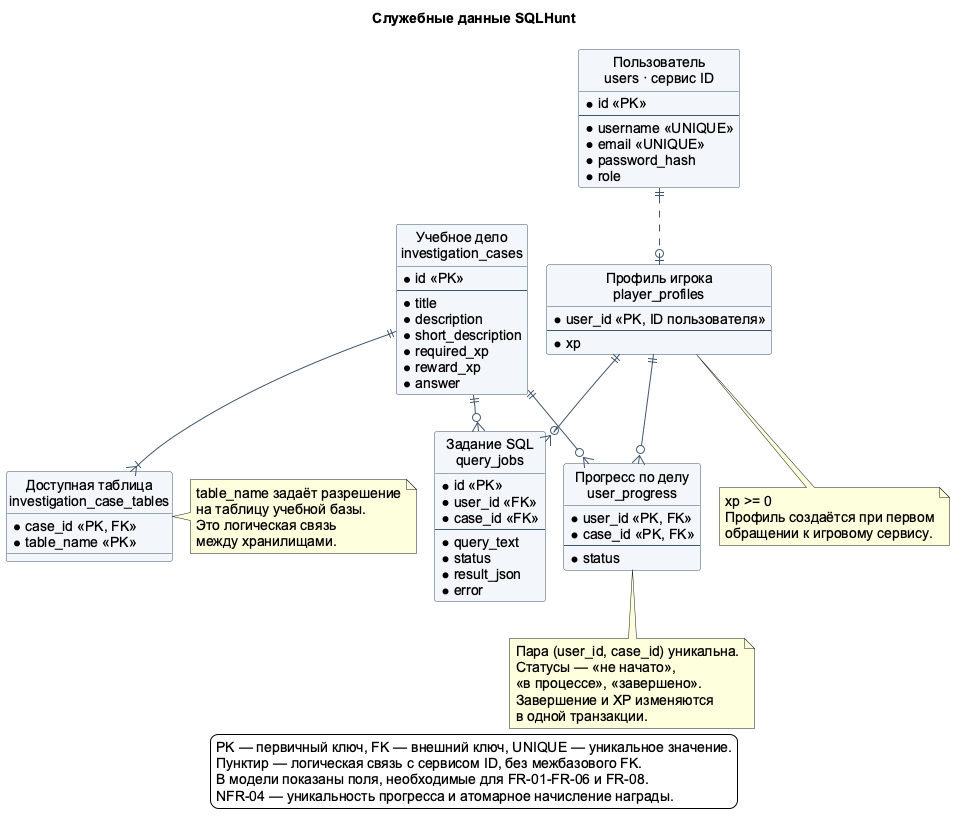
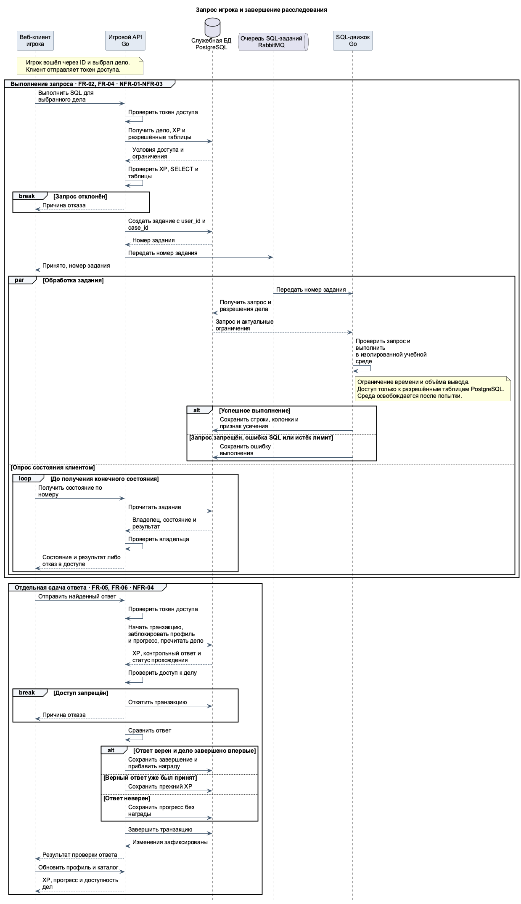
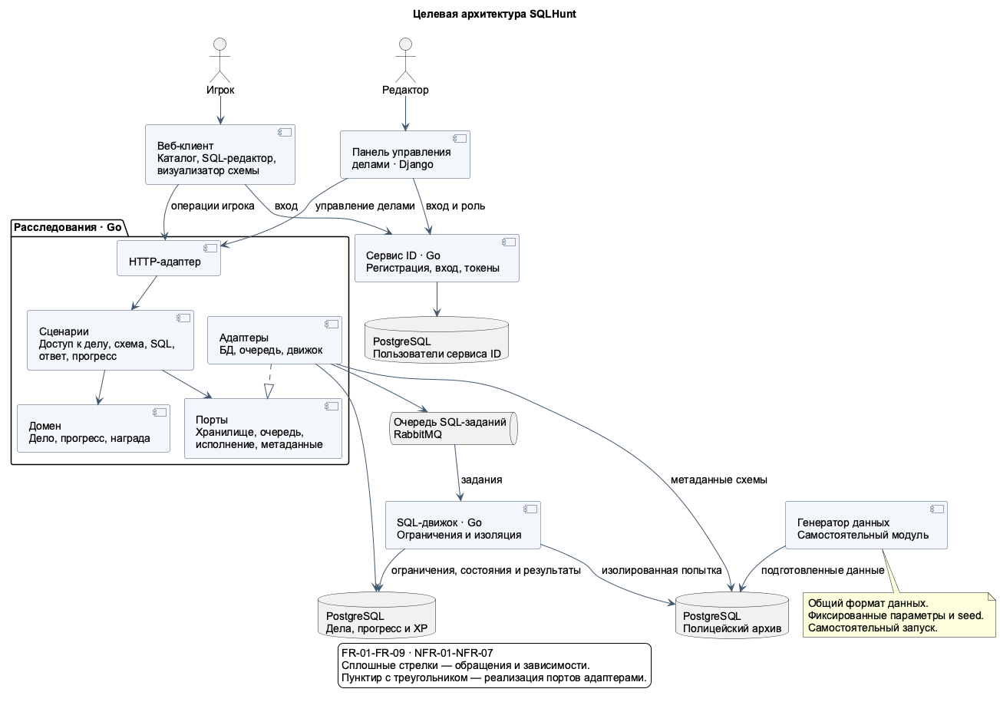
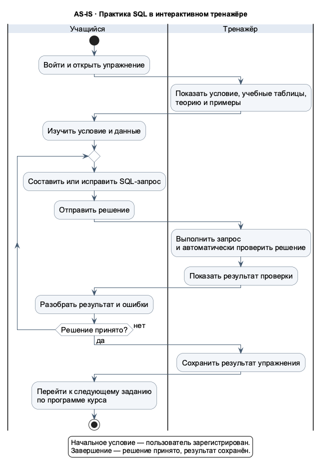

# ЛР 3 — проектирование

**Тема ВКР:** Разработка веб-платформы SQLHunt для изучения языка SQL на основе интерактивных детективных задач

**Авторы:** Якшин Артемий, Преображенский Артемий

**Вклад участников:**

- **Якшин Артемий** — проектирование клиентской части: каталога дел, редактора запросов, визуализатора схемы базы данных и взаимодействия пользователя с платформой.
- **Преображенский Артемий** — проектирование серверной части: модели данных, генератора, аутентификации, выполнения и проверки запросов.
- **Совместно** — формирование требований, выбор нотаций, согласование моделей и описание перехода от существующего процесса обучения к SQLHunt.

## 1. Предметная область и требования

### Описание предметной области

SQLHunt — браузерная игра для изучения SQL на основе интерактивных детективных задач. Пользователь выступает в роли следователя и раскрывает дела, исследуя учебную базу данных «Полицейский архив». В ней хранятся сведения о происшествиях, людях, подозреваемых, показаниях, алиби, местах преступлений, уликах и обвинениях.

После регистрации пользователь получает профиль игрока и доступ к первому делу. Каждое дело содержит сюжет, вопрос, награду, порог опыта и список доступных таблиц. Игрок изучает интерактивную схему базы данных, формулирует версии и проверяет их с помощью SELECT-запросов. Одно расследование может потребовать нескольких запросов: промежуточные результаты используются для сопоставления улик, показаний и сведений о подозреваемых.

SQL-запрос и ответ на вопрос дела являются разными действиями. Результат запроса помогает игроку провести расследование, а найденный ответ отправляется на отдельную проверку. При первом правильном ответе дело получает статус «завершено», игроку начисляется опыт, а в каталоге открываются следующие дела. Сложность последовательно возрастает от простых выборок и фильтрации до соединений, агрегатных функций, подзапросов, оконных функций и общих табличных выражений.

Платформа включает веб-клиент, сервис аутентификации и авторизации на Go, игровой сервис на Go, SQL-движок на Go, административную панель Django и модуль генерации синтетических данных. Служебные и учебные данные хранятся в PostgreSQL. Административная панель предназначена для управления делами, а генератор создаёт связанные фоновые и сюжетные записи «Полицейского архива».

В системе предусмотрены три роли:

- **гость** регистрируется и входит в систему;
- **игрок** выбирает дела, выполняет запросы, отправляет ответы и получает опыт;
- **редактор** создаёт и изменяет учебные дела через административную панель.

### Функциональные требования

Таблица 1 — Функциональные требования к SQLHunt

| ID | Требование | Способ проверки |
|---|---|---|
| FR-01 | Пользователь регистрируется и входит через сервис аутентификации и авторизации на Go. После повторного входа ему доступен собственный профиль. | Зарегистрировать пользователя, завершить сеанс и войти повторно. Проверить сохранение профиля и отказ при неверном пароле. |
| FR-02 | Игрок видит каталог дел, статус их прохождения и доступность по накопленному опыту. Для доступного дела отображаются сюжет и вопрос. | Сравнить каталог до и после начисления опыта. Проверить отказ при попытке открыть недоступное дело прямым запросом. |
| FR-03 | Для выбранного дела отображается интерактивная схема разрешённых таблиц с названиями, полями, типами данных, описаниями и связями. | Открыть дела с разными наборами таблиц, сверить схему с метаданными PostgreSQL, проверить перемещение узлов и масштабирование. |
| FR-04 | Игрок вручную составляет SELECT-запрос, после чего SQL-движок асинхронно выполняет его и возвращает колонки и строки результата. | Выполнить выборку и запрос с JOIN на контрольном наборе данных, сверить результат и проверить отображение состояния выполнения. |
| FR-05 | Игрок отдельно отправляет найденный ответ на вопрос дела, а система сравнивает его с контрольным ответом. | Отправить неверный и верный ответы, проверить разные результаты обработки и возможность продолжить расследование после ошибки. |
| FR-06 | При первом правильном ответе система сохраняет завершение дела и однократно начисляет награду в XP. Прогресс сохраняется между сеансами. | Завершить дело, войти повторно и проверить профиль. Повторно отправить правильный ответ и убедиться, что XP не начисляется второй раз. |
| FR-07 | При запрещённом запросе, ошибке SQL, превышении лимита или неверном ответе игрок получает понятное сообщение на русском языке и может продолжить расследование. | Последовательно вызвать каждый вид ошибки и после него выполнить следующую попытку в том же деле. |
| FR-08 | Редактор управляет делами через административную панель Django: задаёт сюжет, вопрос, контрольный ответ, список таблиц, порог и награду XP. | Создать и изменить дело под ролью редактора, затем проверить согласованное отображение данных в игровом клиенте. |
| FR-09 | Генератор создаёт синтетические фоновые и сюжетные записи «Полицейского архива» с заданным объёмом данных. | Сгенерировать контрольный набор, проверить количество записей, внешние ключи и результат контрольного запроса для дела. |

### Нефункциональные требования

Таблица 2 — Нефункциональные требования к SQLHunt

| ID | Требование | Способ проверки |
|---|---|---|
| NFR-01 | Доступ к профилю, делам, результатам запросов и административной панели предоставляется только после проверки личности и роли пользователя. | Проверить отказ гостю, игроку с недостаточным XP, игроку при обращении к панели редактора и пользователю при запросе чужого результата. |
| NFR-02 | Пользовательские запросы выполняются изолированно, только для разрешённых таблиц учебной базы. Разрешён только SELECT; служебные и исходные учебные данные не должны изменяться. | Отправить запрос к запрещённой таблице и команды изменения данных, затем проверить отказ и сохранность баз. |
| NFR-03 | Одна попытка выполнения SQL ограничена 3 секундами и 1 000 строками результата. | Выполнить долгий запрос и запрос с результатом более 1 000 строк, проверить остановку по времени и признак усечения результата. |
| NFR-04 | Завершение дела и начисление опыта выполняются атомарно. Параллельные и повторные правильные ответы дают не более одной награды. | Одновременно отправить два правильных ответа и проверить одну запись завершения и однократное увеличение XP. |
| NFR-05 | При одинаковых параметрах и начальном значении генератора формируется одинаковый набор данных. Все внешние ссылки и сюжетные записи сохраняют целостность. | Сгенерировать два набора, сравнить упорядоченные записи, проверить внешние ключи и контрольные ответы. |
| NFR-06 | Генератор запускается как самостоятельный модуль без веб-клиента, игровых сервисов и Django. На контрольном объёме из 1 500 человек, 500 подозреваемых и 100 обвинений его медианное время пяти запусков должно быть меньше времени существующего генератора. | Выполнить по пять запусков обеих реализаций на одном стенде и сравнить медианное время от запуска до готовности проверенного набора. |
| NFR-07 | Доменная логика Go-сервисов не зависит от HTTP, очереди и конкретной СУБД; внешние компоненты подключаются через интерфейсы. | Проверить направления зависимостей пакетов и выполнить сценарии проверки ответа и прогресса с тестовыми реализациями хранилищ. |

## 2. Обзор нотаций и видов диаграмм

Таблица 3 — Обзор нотаций и видов диаграмм

| Нотация или вид диаграммы | Что описывает | Применение при проектировании SQLHunt |
|---|---|---|
| IDEF0 | Функции системы, входы, выходы, управление и механизмы | Подходит для функциональной декомпозиции подготовки данных, проведения расследования и проверки результата. |
| UML, диаграмма вариантов использования | Акторов и доступные им функции | Показывает границы возможностей гостя, игрока и редактора. |
| UML, диаграмма деятельности | Последовательность действий, условия и циклы | Позволяет представить процесс обучения, повторные SQL-запросы и возврат к расследованию после ошибки. |
| UML, диаграмма последовательности | Обмен сообщениями между участниками во времени | Показывает асинхронное выполнение SQL, получение результата и отдельную проверку ответа. |
| UML, диаграмма классов | Структуру понятий предметной области, их свойства и связи | Подходит для описания дела, прогресса, награды и правил доступности. |
| UML, диаграмма состояний | Жизненный цикл объекта и условия переходов | Может использоваться для состояний расследования и задания на выполнение SQL. |
| UML, диаграмма компонентов | Программные части системы и зависимости между ними | Позволяет распределить ответственность между клиентом, Go-сервисами, Django, SQL-движком и генератором. |
| UML, диаграмма развёртывания | Узлы выполнения, размещение компонентов и сетевые связи | Подходит для описания размещения сервисов, PostgreSQL и очереди заданий. |
| ER-модель | Сущности данных, их атрибуты, ключи, связи и кратности | Показывает структуру служебных данных и учебного «Полицейского архива». |

## 3. Выбор нотаций для проекта

Для проектирования SQLHunt выбраны четыре вида диаграмм: UML-диаграмма деятельности, ER-модель, UML-диаграмма последовательности и UML-диаграмма компонентов.

Таблица 4 — Связь выбранных моделей с требованиями

| Вид диаграммы | Объект моделирования | Связанные требования | Обоснование выбора |
|---|---|---|---|
| UML, диаграмма деятельности | Практика SQL в существующем тренажёре и расследование в SQLHunt | FR-01–FR-07, NFR-01–NFR-04 | Одна нотация позволяет сопоставить AS-IS и TO-BE, показать действия пользователя, автоматическую проверку и циклы повторных попыток. |
| ER-модель | Служебные данные платформы и учебная база «Полицейский архив» | FR-01–FR-06, FR-08, FR-09, NFR-02, NFR-04, NFR-05 | Модель фиксирует структуру данных, ключи и кратности, необходимые для каталога, прогресса, расследований и генерации. |
| UML, диаграмма последовательности | Выполнение SQL-запроса и завершение дела | FR-02, FR-04–FR-07, NFR-01–NFR-04 | Диаграмма показывает порядок проверок, асинхронное выполнение, получение результата и транзакцию начисления XP. |
| UML, диаграмма компонентов | Целевая архитектура платформы | FR-01–FR-09, NFR-01–NFR-07 | Диаграмма распределяет ответственность между компонентами и показывает изоляцию учебных данных и направление зависимостей. |

ER-модель разделена на две диаграммы. Первая описывает данные пользователей, дел и прогресса, вторая — предметную область учебных расследований. Такое разделение соответствует физическому разделению служебных и учебных данных и упрощает контроль доступа.

## 4. Модели системы

### 4.1 ER-модель служебных данных

Рисунок 1 — Служебные данные SQLHunt

Пользователь регистрируется в сервисе аутентификации и получает уникальный идентификатор. Учётная запись содержит роль, которая определяет доступ к функциям игрока и редактора. В игровом сервисе идентификатору пользователя соответствует профиль с количеством XP. Данные пользователя и профиль хранятся раздельно, поэтому связь между ними является логической.

Сущность `investigation_cases` содержит условия учебного дела: название, описание, порог опыта, награду и контрольный ответ. Список таблиц, доступных в конкретном деле, хранится в `investigation_case_tables`. Запись `user_progress` связывает профиль с делом и содержит статус прохождения. Составной первичный ключ не допускает нескольких записей прогресса для одной пары «игрок — дело». Сущность `query_jobs` хранит текст запроса, состояние асинхронного задания, результат или ошибку и связывает каждую попытку с игроком и делом.

Поля `required_xp` и `reward_xp` обеспечивают FR-02 и FR-06. Контрольный ответ используется для FR-05, список таблиц — для FR-03 и FR-04, а владелец задания — для проверки доступа к результату по NFR-01. Уникальность прогресса и изменение прогресса вместе с XP в одной транзакции обеспечивают NFR-04.

### 4.2 ER-модель учебных данных

Рисунок 2 — Учебная база «Полицейский архив»

Центральной сущностью учебной базы является расследование `cases`. С ним связаны места преступлений, показания, подозреваемые и алиби. Каждое место преступления содержит набор улик. Показание связывает человека с расследованием, а сущность `suspect` позволяет представить человека в роли подозреваемого. Связь `suspect_cases` задаёт участие подозреваемого в конкретном расследовании. Обвинение связывает подозреваемого со статьёй.

Учебное дело в каталоге и расследование в «Полицейском архиве» имеют разное назначение. Учебное дело определяет вопрос, награду и доступные таблицы, а расследование содержит данные, которые анализирует игрок. Номер расследования или другие необходимые условия задаются в тексте учебного дела.

Связи `cases → crime_scene → evidence`, `cases → statement → person` и `cases → suspect_cases → suspect` позволяют строить задания на соединения, группировку и подзапросы. Уникальные пары `(case_id, person_id)` для показаний и `(case_id, suspect_id)` для алиби исключают дублирование записей внутри одного расследования. Эти ограничения используются генератором и обеспечивают целостность данных по NFR-05.

### 4.3 Диаграмма последовательности

Рисунок 3 — Выполнение SQL-запроса и проверка ответа

После выбора дела клиент отправляет SQL-запрос игровому API. API проверяет токен, количество XP, тип запроса и список используемых таблиц, создаёт запись задания и передаёт его номер через RabbitMQ. Клиент также получает номер задания. SQL-движок загружает запрос и ограничения дела, выполняет его в изолированной среде PostgreSQL и сохраняет состояние, результат или ошибку в служебной базе. Клиент опрашивает состояние задания по его номеру.

Проверка владельца задания не позволяет одному пользователю получить результат другого пользователя и обеспечивает NFR-01. Ограничение таблиц и запрет команд изменения данных обеспечивают NFR-02. Ограничения времени и количества строк соответствуют NFR-03.

Ответ на вопрос дела отправляется отдельным запросом. Игровой API блокирует профиль и запись прогресса, проверяет доступ к делу и сравнивает ответ с контрольным значением. При первом правильном ответе завершение дела и награда XP сохраняются в одной транзакции. Повторный правильный ответ не изменяет XP, что обеспечивает NFR-04.

### 4.4 Диаграмма компонентов

Рисунок 4 — Целевая архитектура SQLHunt

Игрок взаимодействует с веб-клиентом, который содержит каталог дел, SQL-редактор и визуализатор схемы. Регистрацию, вход и выдачу токенов выполняет сервис аутентификации и авторизации на Go. Игровой сервис на Go управляет доступностью дел, схемой, запросами, ответами и прогрессом. SQL-движок на Go выполняет пользовательские запросы с заданными ограничениями.

Редактор работает с делами через административную панель Django. Изменения передаются игровому сервису, который применяет общие правила доступа и целостности. Генератор запускается как самостоятельный модуль и создаёт воспроизводимый набор учебных данных PostgreSQL по заданным параметрам.

Игровой сервис построен по принципам чистой архитектуры. Входные адаптеры вызывают сценарии использования, сценарии применяют доменные правила и обращаются к интерфейсам хранилища, очереди, выполнения и метаданных. Инфраструктурные адаптеры реализуют эти интерфейсы. Поэтому доменная логика доступности дела, прогресса и награды не зависит от HTTP, RabbitMQ и PostgreSQL, что обеспечивает NFR-07.

Раздельные базы пользователей, игровых данных и учебного архива ограничивают доступ SQL-движка и обеспечивают NFR-01 и NFR-02. Очередь RabbitMQ отделяет приём запроса от его выполнения. Самостоятельный генератор и фиксируемое начальное значение генерации обеспечивают NFR-05 и NFR-06.

## 5. AS-IS и TO-BE

**Выбранная нотация:** UML-диаграмма деятельности.

Сравнивается процесс практического изучения SQL. AS-IS представляет работу учащегося в интерактивном тренажёре с последовательностью упражнений. TO-BE представляет прохождение детективного дела в SQLHunt. Границы обоих процессов одинаковы: пользователь открывает задание, работает с учебными данными, получает обратную связь и после успешного решения переходит к следующему заданию.

### 5.1 AS-IS — практика в интерактивном тренажёре

Рисунок 5 — Процесс практики SQL в интерактивном тренажёре

Тренажёр показывает условие упражнения, структуру учебных таблиц, теорию и примеры. Учащийся составляет запрос и отправляет его на автоматическую проверку. Если решение не принято, он анализирует сообщение об ошибке и исправляет запрос. После принятия решения результат сохраняется, а пользователь переходит к следующему упражнению программы.

Процесс обеспечивает последовательную практику и быструю обратную связь, однако цель каждого упражнения заранее сформулирована как требуемый результат запроса. Работа сводится к поиску одного решения для отдельной задачи. Между упражнениями нет общего расследования, самостоятельного выдвижения версий и игровой прогрессии.

### 5.2 TO-BE — расследование в SQLHunt

Рисунок 6 — Процесс обучения через расследование в SQLHunt

В SQLHunt игрок выбирает доступное дело, знакомится с сюжетом и вопросом, затем изучает схему разрешённых таблиц. Он формулирует версию и выполняет несколько SQL-запросов, сопоставляя результаты с уликами. Ошибка запроса возвращает игрока к редактору, а недостаточно обоснованная версия — к исследованию данных.

Найденный ответ отправляется отдельно от SQL-запроса. При неверном ответе игрок возвращается к расследованию. При правильном ответе система в одной транзакции сохраняет завершение и начисляет опыт, после чего обновляет доступность следующих дел. Процесс отражает FR-01–FR-07 и ограничения NFR-01–NFR-04.

### 5.3 Обоснование перехода

Таблица 5 — Изменения процесса обучения

| Элемент процесса | AS-IS | TO-BE | Проектное решение |
|---|---|---|---|
| Постановка задачи | Требуемый результат запроса прямо задан в условии | Сюжет и вопрос задают цель, а игрок самостоятельно формулирует версии | Учебные дела и связанный «Полицейский архив», FR-02, рисунки 1–2 |
| Работа со структурой данных | Используется описание таблиц упражнения | Отображается интерактивная схема таблиц конкретного дела | Метаданные PostgreSQL и визуализатор схемы, FR-03, рисунки 2 и 4 |
| Поиск решения | Составляется запрос для одного заранее определённого результата | Выполняется последовательность запросов для проверки версий и сопоставления улик | Асинхронный SQL-движок, FR-04 и FR-07, рисунки 3 и 6 |
| Проверка результата | Проверяется решение упражнения | Отдельно проверяется найденный ответ на вопрос расследования | Механизм контрольного ответа, FR-05, рисунки 1 и 3 |
| Продвижение | Переход к следующему упражнению программы | Сохранение прогресса, начисление XP и открытие новых дел | Профиль и транзакция награды, FR-06, рисунки 1 и 3 |
| Учебные данные | Отдельный набор данных для упражнения | Общий синтетический архив со связанными фоновыми и сюжетными записями | Генератор данных, FR-09, NFR-05 и NFR-06, рисунки 2 и 4 |

Переход к SQLHunt сохраняет автоматическую проверку и возможность повторных попыток. К ним добавляются исследование связанной предметной области, несколько запросов в рамках одного дела, отдельная проверка вывода игрока и прогрессия по опыту. Диаграммы показывают, какими компонентами и данными обеспечивается каждое изменение. Результативность нового процесса должна оцениваться при апробации по успешности выполнения SQL-заданий и переносу навыка на новые задачи.

## 6. Выводы

В работе сформулированы девять функциональных и семь нефункциональных требований к SQLHunt. Для проектирования выбраны UML-диаграммы деятельности, последовательности и компонентов, а также ER-модель. Эти виды диаграмм описывают процесс обучения, структуру данных, взаимодействие компонентов и целевую архитектуру платформы.

Модели согласованы через единый сценарий. Игрок входит в систему, открывает доступное по XP дело, получает схему разрешённых таблиц, выполняет SELECT-запросы к учебной базе PostgreSQL и отдельно отправляет найденный ответ. При успешном завершении игровой сервис атомарно изменяет прогресс и XP. Каталог использует обновлённый профиль для открытия следующих дел.

ER-модели связывают условия учебного дела с данными «Полицейского архива». Диаграмма последовательности показывает проверку доступа, асинхронное выполнение SQL и начисление награды. Диаграмма компонентов распределяет ответственность между веб-клиентом, сервисами Go, панелью Django, SQL-движком, PostgreSQL, RabbitMQ и генератором данных.

Сравнение AS-IS и TO-BE показывает переход от выполнения отдельных упражнений к последовательному расследованию. В целевом процессе пользователь самостоятельно формулирует версии, исследует связи данных несколькими запросами и получает доступ к новым делам по мере накопления опыта. Спроектированные модели определяют согласованную основу для дальнейшей реализации и проверки платформы.
