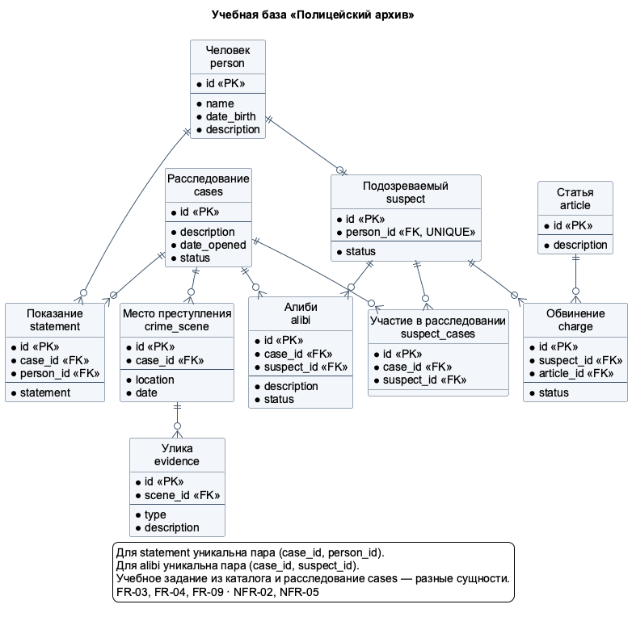
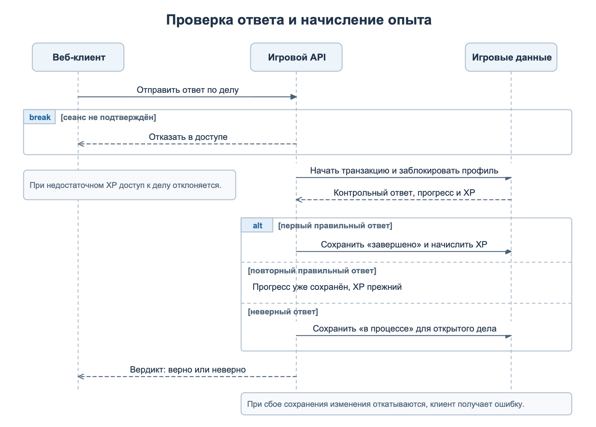

# Лабораторная работа № 3 — Проектирование информационных систем

**Тема ВКР:** Разработка веб-платформы SQLHunt для изучения языка SQL на основе интерактивных детективных задач

**Авторы:** Якшин Артемий, Преображенский Артемий

**Вклад участников:**

- **Якшин Артемий** — проектирование клиентской части: каталога дел, редактора запросов, визуализатора схемы базы данных и взаимодействия пользователя с платформой.
- **Преображенский Артемий** — проектирование серверной части: модели данных, генератора, аутентификации, выполнения и проверки запросов.
- **Совместно** — формирование требований, выбор нотаций, согласование моделей и описание перехода от существующего процесса обучения к SQLHunt.

## 1. Предметная область и требования

### Описание предметной области

SQLHunt — браузерная игра для изучения SQL на основе интерактивных детективных задач. Пользователь выступает в роли следователя и раскрывает дела, исследуя учебную базу данных «Полицейский архив». В ней хранятся сведения о происшествиях, людях, подозреваемых, показаниях, алиби, местах преступлений, уликах и обвинениях.

При первом входе в каталог игрок получает профиль с нулевым опытом. Стартовое дело доступно без опыта. Каждое дело содержит сюжет, вопрос, награду, порог опыта и список доступных таблиц. Игрок изучает интерактивную схему базы данных, формулирует версии и проверяет их с помощью SELECT-запросов. Промежуточные результаты запросов помогают сопоставить улики, показания и сведения о подозреваемых.

SQL-запрос и ответ на вопрос дела являются разными действиями. Результат запроса помогает игроку провести расследование, а найденный ответ отправляется на отдельную проверку. При первом правильном ответе дело получает статус «завершено», игроку начисляется опыт, а в каталоге открываются следующие дела. Сложность последовательно возрастает от простых выборок и фильтрации до соединений, агрегатных функций, подзапросов, оконных функций и общих табличных выражений.

В целевой модели игрок работает с каталогом, SQL-редактором и личным кабинетом. Редактор управляет делами в административной панели и запускает подготовку учебного набора. Генератор создаёт синтетические фоновые записи и сохраняет данные, на которых основаны сюжеты дел.

В системе предусмотрены три роли:

- **гость** регистрируется и входит в систему;
- **игрок** выбирает дела, выполняет запросы, отправляет ответы и получает опыт;
- **редактор** создаёт и изменяет учебные дела и запускает генерацию через административную панель.

### Функциональные требования

Таблица 1 — Функциональные требования к SQLHunt

| ID | Требование | Критерий приёмки |
|---|---|---|
| FR-01 | Система должна создавать учётную запись по корректным регистрационным данным. | Регистрация с новым адресом электронной почты создаёт одну учётную запись. Повторная регистрация с тем же адресом отклоняется. |
| FR-02 | Система должна показывать игроку каталог со статусами дел и доступностью по накопленному опыту (XP). | При XP ниже порога дело отмечено как недоступное. После достижения порога оно становится доступным. |
| FR-03 | Для открытого дела система должна показывать интерактивную схему разрешённых таблиц с названиями, полями, типами, описаниями на русском языке и связями. | Для двух дел с разными наборами таблиц схема совпадает с разрешённой частью учебных данных. Узлы можно перемещать, а схему масштабировать. |
| FR-04 | Система должна принимать запросы на чтение в диалекте PostgreSQL для открытого дела, присваивать принятому заданию номер и показывать по нему состояние и результат. | На фиксированном наборе принятые выборка и запрос с JOIN получают номера. Колонки и строки результатов совпадают с эталоном. |
| FR-05 | Система должна отдельно принимать ответ игрока на вопрос дела и сообщать результат сравнения с контрольным ответом. | Верный и неверный ответы дают разные результаты проверки. Успешный SQL-запрос сам по себе не завершает дело. |
| FR-06 | При первом правильном ответе система должна отмечать дело как завершённое и увеличивать XP на награду за дело. | При начальном опыте X и награде R после прохождения отображаются статус «завершено» и X + R XP. Данные сохраняются после повторного входа. |
| FR-07 | При отклонении запроса, ошибке SQL, истечении срока или недоступности выполнения система должна сообщать причину на русском языке и позволять отправить новый запрос в том же деле. | Для каждого случая показана соответствующая категория ошибки. После устранения причины игрок может отправить новый запрос с сохранённым прогрессом. |
| FR-08 | Система должна позволять редактору создавать и изменять дела через административную панель, включая сюжет, вопрос, контрольный ответ, список таблиц, порог и награду XP. | После изменения игрок видит новые условия и схему. При прохождении система применяет сохранённые контрольный ответ, порог и награду. |
| FR-09 | Система должна позволять редактору запускать из панели генерацию учебных данных с заданным объёмом фоновых записей и видеть итог операции. | Готовый набор содержит заданное число людей, подозреваемых и обвинений, сохраняет сюжетные записи, удовлетворяет ограничениям связей и проходит контрольные запросы. При сбое панель показывает ошибку. |
| FR-10 | Система должна предоставлять зарегистрированному пользователю вход по действительным учётным данным. | Верные данные открывают свою учётную запись. Вход с неверным паролем отклоняется. |
| FR-11 | Система должна показывать в личном кабинете имя игрока, накопленный XP и статусы прохождения дел. | После завершения дела и повторного входа в кабинете отображаются обновлённый XP и сохранённый статус. |
| FR-12 | Система должна открывать сюжет и вопрос дела при достижении его порога XP. | При XP на единицу ниже положительного порога прямое открытие отклоняется. При XP, равном порогу, сюжет и вопрос доступны. |

### Нефункциональные требования

Таблица 2 — Нефункциональные требования к SQLHunt

| ID | Требование | Критерий приёмки |
|---|---|---|
| NFR-01 | Личный кабинет и результаты SQL-заданий должны быть доступны только владельцу. Изменение дел и генерация данных должны быть доступны только редактору. | Проверки от имени гостя, двух игроков и редактора дают 0 успешных обращений без нужных прав. Разрешённые обращения выполняются. |
| NFR-02 | Пользовательский SQL должен иметь доступ на чтение только к разрешённым учебным данным выбранного дела. При таких попытках исходные учебные и служебные данные должны сохраняться без изменений. | Разрешённая выборка выполняется. Доступ к запрещённым данным и запись отклоняются. Сравнение исходных учебных и защищённых служебных записей даёт 0 изменений. |
| NFR-03 | Движок должен отменять незавершённую попытку по истечении 3 секунд с начала подготовки учебной среды. В бюджет входит выполнение SQL. | Попытка, не завершённая за 3 секунды, отменяется с ошибкой по времени. Ожидание в очереди измеряется отдельно. |
| NFR-04 | Статус завершения и награда XP должны сохраняться атомарно. Для одной пары «игрок — дело» допускается одно начисление. | Две одновременные и одна повторная отправка верного ответа дают одну запись завершения и прирост XP ровно на размер награды. При сбое записи сохраняются прежние статус и XP. |
| NFR-05 | При одинаковых параметрах, начальном значении и версиях генератора, справочников и сюжетных данных набор должен воспроизводиться. | Два запуска на пустом хранилище дают 0 различий в содержимом учебных таблиц после упорядочивания записей. |
| NFR-06 | На объёме 1 500 человек, 500 подозреваемых и 100 обвинений медианное время подготовки готового набора обновлённым генератором должно быть ниже медианы базового генератора на Faker. | На одном стенде выполнить по 5 запусков фиксированных версий с одинаковыми входными данными и условиями записи. Измерять время от запуска до готовности набора, прошедшего одинаковые проверки. Отношение медиан новой и базовой версий меньше 1. |
| NFR-07 | Регистрация и вход должны оставаться доступны при недоступности игрового сервиса и штатной работе подсистемы учётных записей и входного шлюза. | При остановленном игровом сервисе регистрация и вход через обычную точку входа завершаются успешно. |
| NFR-08 | Успешный результат SQL-запроса должен содержать не более 1 000 строк, с отметкой об усечении при превышении. | Запрос на 1 001 строку, укладывающийся в остальные лимиты, возвращает 1 000 строк с отметкой. При результате из 1 000 строк отметки нет. |
| NFR-09 | Срок принятого SQL-задания должен составлять 30 секунд с момента приёма, включая очередь и попытки выполнения. | Если задание осталось незавершённым к истечению срока, первое последующее чтение статуса возвращает конечную ошибку по времени. |

## 2. Обзор нотаций и видов диаграмм

Таблица 3 — Обзор нотаций и видов диаграмм

| Нотация или вид диаграммы | Что описывает | Применение при проектировании SQLHunt |
|---|---|---|
| IDEF0 | Функции системы, входы, выходы, управление и механизмы | Подходит для функциональной декомпозиции подготовки данных, проведения расследования и проверки результата. |
| UML, диаграмма вариантов использования | Акторов и доступные им функции | Показывает границы возможностей гостя, игрока и редактора. |
| UML, диаграмма деятельности | Последовательность действий, условия и циклы | Позволяет представить процесс обучения, повторные SQL-запросы и возврат к расследованию после ошибки. |
| UML, диаграмма последовательности | Обмен сообщениями между участниками во времени | Показывает асинхронное выполнение SQL, получение результата и отдельную проверку ответа. |
| UML, диаграмма классов | Структуру понятий предметной области, их свойства и связи | Подходит для описания дела, прогресса, награды и правил доступности. |
| UML, диаграмма состояний | Жизненный цикл объекта и условия переходов | Может использоваться для состояний расследования и задания на выполнение SQL. |
| UML, диаграмма компонентов | Программные части системы и зависимости между ними | Позволяет распределить ответственность между клиентом, Go-сервисами, Django, SQL-движком и генератором. |
| UML, диаграмма развёртывания | Узлы выполнения, размещение компонентов и сетевые связи | Подходит для описания размещения сервисов, PostgreSQL и очереди заданий. |
| ER-модель | Сущности данных, их атрибуты, ключи, связи и кратности | Показывает структуру служебных данных и учебного «Полицейского архива». |
| C4, диаграмма контейнеров | Границу системы, пользователей, приложения и хранилища | Показывает отдельно запускаемые части SQLHunt и обмен данными между ними. |

## 3. Выбор нотаций для проекта

Таблица 4 — Связь выбранных моделей с требованиями

| Вид диаграммы | Объект моделирования | Связанные требования | Обоснование выбора |
|---|---|---|---|
| UML, диаграмма деятельности | Практика SQL на Stepik и расследование в SQLHunt (рисунки 6 и 7) | FR-02–FR-07, FR-12 | Дорожки отделяют действия учащегося от действий платформы, а ветвления и циклы показывают, когда учащийся продолжает поиск или переходит к следующему заданию. |
| ER-модель в нотации Crow’s Foot | Служебные и учебные данные (рисунки 1 и 2) | FR-01–FR-06, FR-08–FR-12, NFR-01, NFR-04, NFR-05 | Кратности и ключи показывают, как хранятся разрешения на таблицы, прогресс игрока, результаты запросов и связи записей архива. |
| UML, диаграмма последовательности | Выполнение SQL и проверка ответа (рисунки 3 и 4) | FR-04–FR-07, FR-12, NFR-01–NFR-04, NFR-08, NFR-09 | На первой схеме видны границы асинхронного выполнения, на второй — границы транзакции, в которой сохраняются завершение и XP. |
| C4, диаграмма контейнеров | Целевая архитектура платформы (рисунок 5) | FR-01–FR-12, NFR-01, NFR-02, NFR-05–NFR-07 | Граница SQLHunt и связи контейнеров показывают, где проверяются права, где выполняется SQL и какие хранилища доступны каждому сервису. |

## 4. Модели системы

### 4.1 ER-модель служебных данных

Рисунок 1 — Служебные данные SQLHunt

**Пояснение модели.** Игровой профиль создаётся при первом обращении к игровому сервису. Его `user_id` совпадает с идентификатором учётной записи в сервисе ID. Пунктиром показаны логические связи по идентификаторам между учётными данными, игровой схемой PostgreSQL и заданиями в Redis.

**Функциональные требования.** Учётная запись `users` используется при регистрации и входе (FR-01, FR-10). В личном кабинете отображаются имя пользователя, XP профиля и статусы из `user_progress` (FR-11). Порог `required_xp` и XP определяют доступность дела (FR-02, FR-12). Список `investigation_case_tables` определяет, какие таблицы видны на схеме и доступны для запросов (FR-03, FR-04). Запись задания в Redis хранит состояние, результат либо ошибку. В `investigation_cases` хранятся сюжет с вопросом, контрольный ответ `answer` и параметры XP, которые задаёт редактор (FR-05, FR-06, FR-08).

**Нефункциональные требования.** Поле `role` определяет полномочия редактора, а `user_id` в записи задания позволяет выдавать результат его владельцу (NFR-01). Составной ключ `user_progress` исключает дублирование прохождения для пары «игрок — дело». Вместе с транзакцией на рисунке 4 это обеспечивает однократное начисление XP (NFR-04).

### 4.2 ER-модель учебных данных

Рисунок 2 — Учебная база «Полицейский архив»

**Пояснение модели.** Запись `cases` описывает происшествие в учебном архиве. Номер происшествия может быть указан в тексте учебного дела из каталога. В архиве с ним связаны места преступления, улики, показания и подозреваемые. Обвинение связывает подозреваемого со статьёй.

**Функциональные требования.** Связь `cases → crime_scene → evidence` позволяет найти улики по делу, а `cases → statement → person` — установить, кому принадлежит показание. Эти связи отображаются в схеме разрешённых таблиц и служат основой для запросов игрока (FR-03, FR-04). Сущности и кратности задают структуру набора, который подготавливает генератор (FR-09).

**Нефункциональные требования.** Внешние ключи задают ограничения целостности учебного набора. В целевой модели для пары «дело — человек» допускается одно показание, а для пары «дело — подозреваемый» — одно алиби. Воспроизводимость проверяется сравнением двух наборов, полученных при одинаковых исходных данных (NFR-05).

### 4.3 UML-диаграмма последовательности выполнения SQL

Рисунок 3 — Асинхронное выполнение SQL-запроса

**Пояснение модели.** После приёма запроса игровой API создаёт в Redis задание со статусом `PENDING` и публикует его в очереди. Движок переводит задание в `STARTED` и выполняет запрос. Клиент продолжает опрос в обоих промежуточных состояниях. `SUCCESS` возвращает результат, `FAILURE` — причину ошибки. Оба статуса завершают опрос.

**Функциональные требования.** API проверяет доступ к делу по XP (FR-12). Передача задания и последующий опрос состояния реализуют асинхронный сценарий, а движок сохраняет колонки, строки и признак усечения (FR-04). При отказе, недоступности очереди или ошибке исполнения клиент получает причину и позволяет повторить попытку в том же деле (FR-07).

**Нефункциональные требования.** Для чтения результата API проверяет токен и ищет задание по номеру и владельцу (NFR-01). Движок выполняет SELECT в учебной области с доступом на чтение только разрешённых таблиц (NFR-02). Бюджет одной попытки равен 3 секундам (NFR-03), а срок задания с очередью и попытками — 30 секундам (NFR-09). Успешный результат ограничен 1 000 строками, при превышении выставляется отметка об усечении (NFR-08).

### 4.4 UML-диаграмма последовательности проверки ответа

Рисунок 4 — Проверка ответа и начисление опыта

**Пояснение модели.** Игрок отправляет найденный ответ после анализа данных. API проверяет токен и доступ к делу, затем сравнивает ответ с контрольным значением. Ветви диаграммы разделяют первое завершение, повторный правильный ответ и неверный ответ.

**Функциональные требования.** Сравнение с `answer` отражает FR-05. Запись завершения, начисление XP и обновление доступности дел соответствуют FR-02 и FR-06. При неверном ответе игрок получает результат проверки и может продолжить расследование (FR-05).

**Нефункциональные требования.** Проверка токена и порога XP ограничивает доступ к сдаче ответа (FR-12, NFR-01). Блокировка строки профиля до чтения статуса упорядочивает параллельные попытки одного игрока. При первом правильном ответе API сохраняет статус «завершено» и увеличивает XP в одной транзакции (NFR-04).

### 4.5 C4-диаграмма контейнеров

Рисунок 5 — Контейнеры SQLHunt

**Пояснение модели.** Входной шлюз принимает HTTP-запросы веб-клиента с JSON и вызывает сервис учётных записей или игровой API по gRPC. Панель Django обращается к шлюзу для входа, а для редактирования дел и генерации данных вызывает соответствующие сервисы по gRPC. Игровой API и движок запускаются отдельными процессами из Go-модуля `investigations`. Очередь Redis Streams передаёт задания, а Redis хранит их состояния и результаты.

**Функциональные требования.** Сервис учётных записей регистрирует пользователей и обеспечивает вход (FR-01, FR-10). Игровой API выдаёт каталог, условия доступных дел, схему и данные личного кабинета (FR-02, FR-03, FR-11, FR-12). Движок получает задания из очереди и записывает итог в Redis (FR-04, FR-07). Игровой API проверяет ответы и сохраняет прогресс (FR-05, FR-06). Из панели редактор меняет условия дел и запускает подготовку учебного набора (FR-08, FR-09).

**Нефункциональные требования и проектные решения.** Сервис учётных записей выдаёт токены. Игровой API проверяет владельца результата, а панель и внутренние сервисы проверяют полномочия редактора (NFR-01). Целевой вариант использует одну базу PostgreSQL со схемами `identity`, `game` и `archive` и раздельными правами. Движок читает разрешения из `game`. Пользовательский SELECT выполняется под отдельной ролью с правами чтения разрешённых данных в `archive` (NFR-02). Генератор записывает в архив набор с заданными параметрами. Воспроизводимость и время генерации проверяются по NFR-05 и NFR-06.

Маршруты регистрации и входа проходят через шлюз к сервису учётных записей и его схеме `identity`. Они остаются доступны при остановке игрового сервиса (NFR-07).

## 5. AS-IS и TO-BE

**Выбранная нотация:** UML-диаграмма деятельности.

Сравнивается практическая работа с несколькими таблицами. AS-IS показывает типовое упражнение на соединения в курсе «Интерактивный тренажер по SQL» на Stepik. TO-BE показывает детективное дело, в котором таблицы нужно соединить, чтобы проверить версию о подозреваемом. В обоих процессах учащийся открывает задание и заканчивает работу после принятия решения платформой.

### 5.1 AS-IS — практика в интерактивном тренажёре

Рисунок 6 — AS-IS. Практика SQL на Stepik

**Описание и ограничения.** Учащийся составляет запрос по условию и отправляет его на проверку. Если выборка не соответствует условию, он уточняет запрос и повторяет попытку. Результат этого цикла — зачёт упражнения по одной итоговой выборке.

### 5.2 TO-BE — расследование в SQLHunt

Рисунок 7 — TO-BE. Расследование в SQLHunt

**Описание изменений.** Условие содержит вопрос о подозреваемом. Игрок по схеме выбирает связи между таблицами и решает, достаточно ли найденных данных для вывода (FR-03, FR-04). Например, он связывает улику с местом преступления, затем ищет показания, которые позволят проверить версию. Если данных не хватает или запрос завершился ошибкой, игрок уточняет следующий запрос (FR-07). Платформа отдельно проверяет вывод. При неверном ответе игрок возвращается к уликам и пересматривает версию (FR-05). Первое правильное решение завершает дело и даёт XP, который влияет на доступность следующих дел (FR-02, FR-06, FR-12).

Проверки прав и разрешённых таблиц соответствуют NFR-01 и NFR-02. Лимиты времени и объёма результата показаны на рисунке 3 (NFR-03, NFR-08, NFR-09), а транзакция завершения — на рисунке 4 (NFR-04).

### 5.3 Обоснование перехода

Таблица 5 — Изменения процесса обучения

| Элемент процесса | AS-IS | TO-BE | Проектное решение |
|---|---|---|---|
| Постановка задачи | Требуемый результат запроса прямо задан в условии | Сюжет и вопрос задают цель, а игрок самостоятельно формулирует версии | Учебные дела и связанный «Полицейский архив», FR-02 и FR-12, рисунки 1–2 |
| Работа со структурой данных | Используется описание таблиц упражнения | Отображается интерактивная схема таблиц конкретного дела | Список разрешённых таблиц и метаданные PostgreSQL, FR-03, рисунки 1, 2 и 5 |
| Повторная попытка | Несовпадение с эталоном возвращает к правке SQL | Недостаток улик ведёт к новому запросу, а неверный вывод — к пересмотру версии | Результаты запросов и отдельный вердикт по делу, FR-04, FR-05 и FR-07, рисунки 3, 4 и 7 |
| Условие завершения | Тренажёр принимает итоговую выборку | Игрок сдаёт вывод, после его подтверждения система завершает дело | Контрольный ответ и запись прогресса, FR-05 и FR-06, рисунки 1 и 4 |
| Продвижение | Переход к следующему упражнению программы | Следующие дела открываются по мере накопления опыта | Профиль, статус прохождения и транзакция награды, FR-02, FR-06 и NFR-04, рисунки 1 и 4 |

В целевом процессе учащийся сам выбирает, какие таблицы связать и какие строки подтвердят его версию. Для оценки переноса навыка можно сравнить долю участников каждого сценария, которые самостоятельно решат новое задание на соединение таблиц без готового плана запроса.

## 6. Выводы

UML-диаграммы деятельности показывают, как меняется учебный процесс при переходе от упражнений к расследованиям. ER-модели задают структуру служебных и учебных данных. Две диаграммы последовательности показывают обмен сообщениями при выполнении SQL и при проверке ответа. C4-диаграмма определяет границы приложений и хранилищ, которые участвуют в этих сценариях.

Список разрешённых таблиц из игровой схемы определяет, какую часть архива показывает визуализатор и к каким данным обращается SQL-движок. Результат задания в Redis связан с игроком, поэтому API может ограничить его выдачу. Транзакция завершения обновляет ту же запись прогресса и баланс XP, которые определяют доступность дел в каталоге.

TO-BE сохраняет автоматическую обратную связь и возможность повторных попыток. Игрок использует интерактивную схему и промежуточные результаты запросов для проверки версий, сдаёт итоговый ответ отдельно и по мере накопления XP открывает новые дела.
