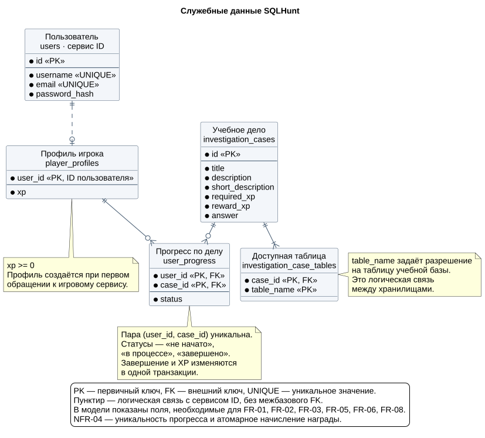
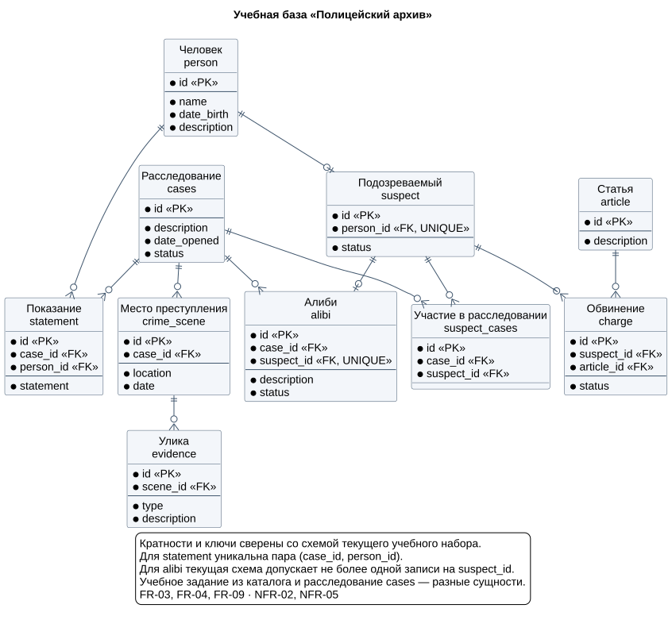
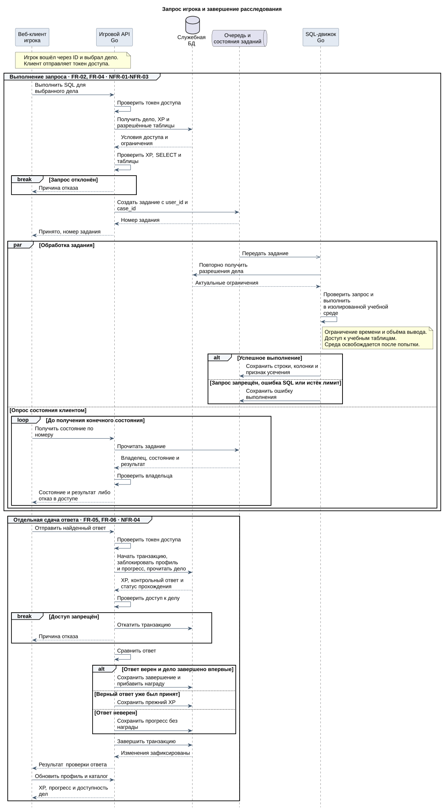
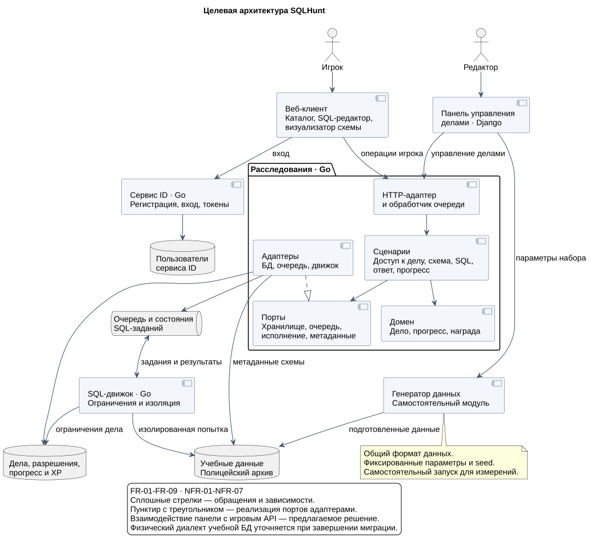
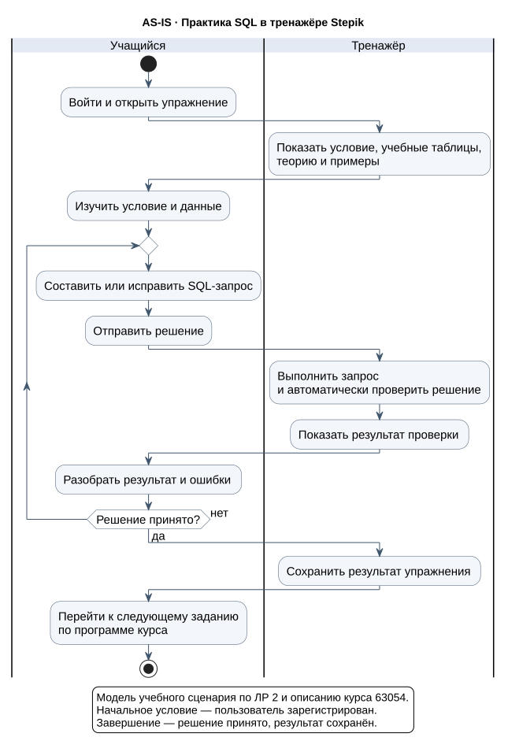
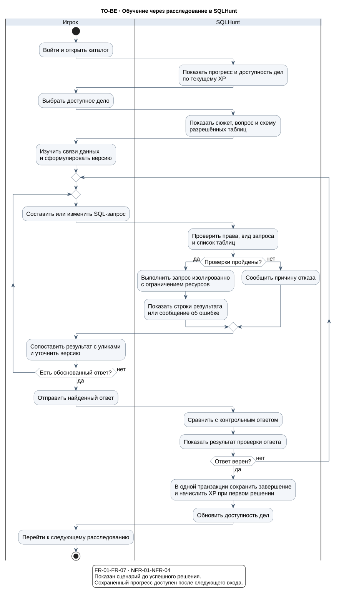

# ЛР 3 — проектирование

**Тема ВКР:** Разработка веб-платформы SQLHunt для изучения языка SQL на основе интерактивных детективных задач

**Авторы:** Якшин Артемий, Преображенский Артемий

**Распределение ответственности по проекту, принятое в ЛР 2:**

- **Якшин Артемий** — клиентская часть, карточки дел, редактор запросов, визуализатор схемы и интеграция с API.
- **Преображенский Артемий** — серверная часть, модель учебных данных, генератор, выполнение и проверка запросов, аутентификация и тесты.

**Проект.** SQLHunt — браузерная игра, в которой учащийся раскрывает детективные дела с помощью SQL-запросов. В ЛР 2 обоснованы сюжетный формат, последовательное усложнение задач, визуализация схемы и автоматическая проверка ответа. В этой работе проектируются процесс расследования, данные и взаимодействие частей платформы. [ЛР 2](../research/report.md)

## 1. Предметная область и требования

### Описание предметной области

Игрок выбирает доступное дело, читает обстоятельства происшествия и изучает схему «полицейского архива». Чтобы найти ответ, он сопоставляет показания, алиби и улики, формулирует версии и проверяет их запросами. Одно расследование может потребовать нескольких запросов. Например, в деле «Серебряный Ключ» нужно связать описание улики с показанием свидетеля и установить идентификатор человека.

После выполнения запроса игрок получает строки результата либо сообщение об ошибке. Найденный ответ он отправляет отдельно. При верном ответе дело завершается, опыт (XP) увеличивается, а игрок получает доступ к следующим расследованиям. Сложность заданий возрастает от простых выборок к соединениям, агрегатам, оконным функциям и общим табличным выражениям. Содержание дел определяет, какие конструкции действительно потребуются для решения.

В системе есть **гость**, который может зарегистрироваться и войти, **игрок**, который проходит расследования, и **редактор**, который управляет учебными делами. Для целевой версии предусмотрены административная панель Django, сервис аутентификации и авторизации на Go, движок выполнения SQL на Go и самостоятельный компактный модуль генерации данных. Генератор создаёт вымышленные фоновые записи и добавляет связанные с сюжетом данные. Формулировка дела, доступные таблицы и контрольный ответ должны соответствовать этому набору.

Go-реализация развивается в проекте `sqlhunt-platform`. Уже существующие части используются как технический задел. Требования ниже описывают целевую платформу и способы её проверки.

### Функциональные требования

Таблица 1 — Возможности SQLHunt

| ID | Требование | Как проверить выполнение |
|---|---|---|
| FR-01 | Пользователь регистрируется и входит через сервис ID на Go. После повторного входа ему доступен собственный профиль. | Зарегистрировать пользователя, завершить сеанс и войти снова. Проверить идентификатор и сохранённый профиль. При неверном пароле вход отклоняется. |
| FR-02 | Игрок видит каталог, статус прохождения и доступность дел по XP. Для доступного дела открываются сюжет и вопрос. | Сравнить каталог до и после достижения порога опыта. Проверить, что открытие закрытого дела по прямому запросу также отклоняется. |
| FR-03 | Для выбранного дела отображаются разрешённые таблицы, поля, типы, описания и связи в интерактивной схеме. | Открыть два дела с разными списками таблиц. Сверить схемы с метаданными и проверить перемещение узлов и масштабирование. |
| FR-04 | Игрок пишет SELECT-запросы вручную. Go-движок асинхронно выполняет допустимый запрос и возвращает колонки и строки результата. | Выполнить выборку и JOIN на фиксированном наборе. Сверить результат с заранее рассчитанным. При долгом запросе клиент показывает состояние ожидания. |
| FR-05 | Система проверяет отдельно отправленный ответ на вопрос дела. | В «Серебряном Ключе» отправить неверный, затем верный идентификатор человека. Проверить разные результаты проверки. |
| FR-06 | При первом правильном ответе сохраняются завершение дела и награда XP. После нового входа сохраняются прогресс и доступность следующих дел. | Завершить дело, войти заново и сверить профиль. Повторная отправка верного ответа сохраняет прежний баланс XP. |
| FR-07 | Игрок получает понятные сообщения о запрещённом запросе, ошибке SQL, истечении времени и неверном ответе. После ошибки он может продолжить расследование. | Для каждого случая вызвать ошибку, проверить сообщение на русском языке и выполнить следующую попытку в том же деле. |
| FR-08 | Редактор управляет делами в панели Django, задаёт текст, контрольный ответ, доступные таблицы, порог и награду XP. | Под редактором изменить учебное дело и проверить согласованное отображение его условий в игровом клиенте. |
| FR-09 | Модуль генерации создаёт синтетический фон заданного объёма и сюжетные записи «полицейского архива». | Создать набор с заданными параметрами, проверить количество записей, связи и ответ на контрольный вопрос дела. |

### Нефункциональные требования

Таблица 2 — Ограничения и критерии проверки

| ID | Требование | Как проверить выполнение |
|---|---|---|
| NFR-01 | Система проверяет личность и права пользователя при обращении к делу, схеме, запросам и панели управления. Результат запроса доступен его владельцу. | С двумя игроками проверить отказ при запросе чужого результата. Проверить отказ гостю, игроку с недостаточным XP и игроку, обращающемуся к функциям редактора. |
| NFR-02 | Учебный запрос выполняется изолированно, с доступом только к разрешённым таблицам. Служебные данные и исходный учебный набор защищены от изменений. | Отправить запрос к служебной таблице, команду изменения данных и запрос к таблице другого дела. Проверить отказ и сохранность исходных данных. |
| NFR-03 | Выполнение ограничено по времени и объёму результата. Для контрольного стенда принимаются 3 секунды на попытку и максимум 1 000 строк результата. | Выполнить тяжёлый запрос и запрос с более чем 1 000 строками. Проверить завершение по лимиту, признак усечения и возможность следующей попытки. |
| NFR-04 | Завершение дела и начисление XP выполняются атомарно. Повторные и одновременные ответы дают не более одной награды за дело. | Отправить два правильных ответа одновременно. Проверить одну запись прогресса и увеличение XP ровно на одну награду. |
| NFR-05 | Генерация воспроизводима при одинаковых параметрах, начальном значении генератора и версиях справочников. Ссылочная целостность и сюжетные записи сохраняются. | Сравнить два набора по упорядоченным строкам, проверить внешние ключи и результат контрольного запроса. |
| NFR-06 | Генератор запускается отдельным модулем без работающих игровых API и Django. На одинаковом контрольном объёме он должен готовить данные быстрее прежнего генератора. | На одном стенде сравнить медианы пяти запусков от старта до готовности проверенного набора. Отдельно зафиксировать время генерации, записи данных, пиковую память и размер модуля. |
| NFR-07 | Доменная логика Go-сервисов отделена от HTTP, очереди и СУБД. Сценарии используют интерфейсы зависимостей. | Проверить зависимости пакетов. Выполнить сценарии проверки ответа и прогресса с тестовыми реализациями хранилищ без запуска инфраструктуры. |

Лимиты NFR-03 взяты из настроек текущего Go-прототипа. Число запусков в NFR-06 выбрано для сравнения реализаций. Контрольный объём соответствует ЛР 2 — 1 500 человек, 500 подозреваемых и 100 обвинений плюс связанные записи. При сравнении фиксируются версии программ, параметры, оборудование и способ подготовки хранилища. Измерение памяти и размера делает требование компактности проверяемым, а конкретные допустимые значения уточняются после базового замера. Результаты измерений в этой работе не приводятся.

## 2. Обзор нотаций и видов диаграмм

В ПР 5 были рассмотрены способы описания функций, действий и обмена сообщениями. В ПР 9 команда дополнила их структурой данных, компонентов и инфраструктуры. Таблица 3 использует этот материал применительно к SQLHunt. [ПР 5](https://drive.google.com/file/d/1tp5f3nBXKJsXpXt2yJ18aQnJuQwAQJOM/view) · [ПР 9](https://drive.google.com/file/d/1AE1XhHQBWbtmMhiDkYhE2kYHr1rYvG9h/view)

Таблица 3 — Нотации и виды диаграмм

| Нотация или вид диаграммы | Что описывает | Сильные стороны для проектирования SQLHunt |
|---|---|---|
| IDEF0 | Функции, входы, выходы, управляющие условия и механизмы | Позволяет разложить обучение на подготовку данных, выполнение задания и оценку результата, указав ресурсы и ограничения каждой функции. |
| UML, варианты использования | Акторов и доступные им действия | Позволяет определить границы возможностей гостя, игрока и редактора. |
| UML, деятельность | Последовательность действий, ветвления и повторения | Показывает цикл расследования и возврат к запросам после ошибки или неподтверждённой версии. |
| UML, последовательность | Обмен сообщениями между участниками во времени | Показывает асинхронное выполнение SQL и отдельную проверку найденного ответа. |
| UML, классы | Понятия предметной области, свойства, поведение и связи | Связывает понятия дела и прогресса с правилами доступности и начисления XP. |
| UML, состояния | Жизненный цикл объекта и условия переходов | Подходит для состояний задания SQL или прохождения дела и проверки допустимости повторного завершения. |
| UML, компоненты | Программные модули, интерфейсы и зависимости | Распределяет обязанности между клиентом, ID, игровой логикой, движком, панелью и генератором. |
| UML, развёртывание | Узлы выполнения и размещение программных частей | Показывает размещение сервисов и хранилищ, связи между ними и границы среды выполнения SQL. |
| ER-модель | Сущности данных, ключи, кратности и ограничения связей | Объясняет связи «полицейского архива», необходимые для запросов игрока, и структуру хранения прогресса. |

## 3. Выбор нотаций для проекта

Таблица 4 — Связь моделей с требованиями

| Вид диаграммы | Что моделируем | Требования | Обоснование |
|---|---|---|---|
| UML, деятельность | Обучение в тренажёре и расследование в SQLHunt, рисунки 5–6 | FR-01–FR-07, NFR-01–NFR-04 | Позволяет проследить путь игрока, повторные попытки, проверку ответа и переход к следующему заданию. |
| ER-модель | Служебные и учебные данные, рисунки 1–2 | FR-01–FR-06, FR-08, FR-09, NFR-02, NFR-04, NFR-05 | Показывает хранение условий доступа и прогресса, связи учебных записей и ограничения для генератора. |
| UML, последовательность | Выполнение SQL и сдача ответа, рисунок 3 | FR-02, FR-04–FR-07, NFR-01–NFR-04 | Определяет место проверок доступа, исполнения запроса и транзакции начисления XP. |
| UML, компоненты | Архитектура всей платформы, рисунок 4 | FR-01–FR-09, NFR-01–NFR-07 | Показывает ответственность модулей, раздельные хранилища, изолированный движок и направление зависимостей. |

Выбраны четыре вида моделей. ER-модель представлена двумя схемами, поскольку служебные данные и учебный архив имеют разное назначение и ограничения доступа. UML-диаграммы деятельности используются также для сравнения AS-IS и TO-BE.

## 4. Модели системы

### 4.1 Служебные данные

На рисунке 1 показаны данные, необходимые для входа, выбора расследования, проверки ответа и сохранения прогресса. У пользователя есть профиль с XP. Для пары «пользователь — учебное дело» существует не более одной записи прогресса. У дела задан список разрешённых учебных таблиц.



Рисунок 1 — Пользователи, учебные дела и прогресс

Связь пользователя с профилем проходит через идентификатор сервиса ID. В текущей реализации это логическая связь между хранилищами. Профиль создаётся при первом обращении к игровому сервису. Для доступного дела требуется хотя бы одна разрешённая таблица. Это условие прикладной проверки при подготовке контента.

Модель отражает FR-01, FR-02, FR-03, FR-05, FR-06 и FR-08. Поля `required_xp` и `reward_xp` определяют доступность и награду, `answer` задаёт контрольный ответ, а `status` сохраняет прохождение. Составной ключ прогресса поддерживает NFR-04. Для защиты от одновременного начисления награды дополнительно нужна транзакция, показанная на рисунке 3.

### 4.2 Учебные данные

На рисунке 2 показан «полицейский архив». Человек может давать показания и фигурировать как подозреваемый. Расследование связано с местами преступлений, уликами, показаниями, подозреваемыми и алиби. Обвинение связывает подозреваемого со статьёй.



Рисунок 2 — Связи учебных данных

Учебное задание в каталоге и запись `cases` в архиве описывают разные понятия. Задание задаёт вопрос игроку, разрешения и награду. Архив содержит сведения о происшествиях, на которых строятся запросы. Связь может задаваться самим условием, например упоминанием номера расследования.

Путь `cases → crime_scene → evidence` позволяет искать улики конкретного происшествия. Через `statement` можно сопоставить показания с людьми, а через `suspect_cases` — проверить участие подозреваемого в расследовании. Эти связи дают основу для заданий на JOIN, группировку и подзапросы.

Ключи и кратности сверены со схемой текущего набора. В частности, `alibi.suspect_id` сейчас уникален и допускает одну запись алиби на подозреваемого. При расширении сюжетов это ограничение потребуется пересмотреть, если одному подозреваемому нужны алиби для нескольких расследований.

Модель поддерживает FR-03, FR-04 и FR-09. Ограничения связей задают проверки целостности для NFR-05. Изолированное хранение учебных записей поддерживает NFR-02. Генератор должен создавать согласованные ссылки и сохранять фиксированные сюжетные записи среди фоновых данных.

### 4.3 Выполнение запроса и проверка ответа

Рисунок 3 начинается после входа игрока. Клиент передаёт токен доступа, а API проверяет XP, допустимый вид запроса и таблицы. После приёма задания клиент получает его номер и запрашивает состояние. Движок повторно проверяет ограничения перед исполнением.



Рисунок 3 — Взаимодействие при расследовании

Ответ на вопрос дела отправляется отдельным действием после анализа результатов SQL. При первой успешной сдаче API изменяет прогресс и XP в одной транзакции. Повторная сдача возвращает результат проверки с прежним балансом опыта. Ветки обработки ошибок позволяют продолжить работу с делом после неудачной попытки.

Схема отражает FR-02, FR-04, FR-05, FR-06 и FR-07. Проверка токена, владельца задания и порога опыта соответствует NFR-01. Изолированная попытка соответствует NFR-02, ограничения времени и вывода — NFR-03, блокировка и общая транзакция — NFR-04. Наличие этих элементов на схеме обосновывает проектные решения. Их реализацию проверяют сценариями из таблиц 1–2.

### 4.4 Архитектура платформы

На рисунке 4 представлены целевые компоненты SQLHunt. Игрок работает через клиент с каталогом, редактором запросов и визуализатором схемы. Редактор использует Django-панель. ID отвечает за регистрацию и вход, игровая часть — за доступность дел, ответы и прогресс, движок — за выполнение SQL, генератор — за подготовку учебных данных.



Рисунок 4 — Целевая архитектура платформы

В Go-части входные адаптеры вызывают сценарии. Сценарии используют доменные правила и порты, а инфраструктурные адаптеры реализуют эти порты. Такое направление зависимостей соответствует чистой архитектуре. Элементы DDD применяются к понятиям и правилам предметной области — доступности дела, состоянию прохождения и награде.

Для взаимодействия Django-панели с игровым сервисом выбран служебный API. Это проектное решение позволяет применять правила изменения дел в одном месте. Редактор задаёт параметры генерации через панель, а модуль также запускается самостоятельно для подготовки наборов и измерений. Его результат используется учебной средой и визуализатором схемы.

Архитектура охватывает FR-01–FR-09. Проверки прав, раздельные служебные и учебные данные, ограниченное исполнение и транзакции связаны с NFR-01–NFR-04. Общий формат данных и самостоятельный модуль генерации поддерживают NFR-05–NFR-06. Зависимости от портов поддерживают NFR-07. Численные показатели скорости и памяти проверяются измерениями.

**СУБД учебной среды.** В ЛР 2 обоснован PostgreSQL, а текущий Go-прототип использует SQLite для изолированных запросов. Диаграммы фиксируют логическую модель и границы доступа. Выбор целевого диалекта остаётся открытым и должен быть согласован с заявленной целью ВКР. При выборе SQLite потребуется актуализировать формулировки ЛР 2 и проверить переносимость предусмотренных учебных конструкций SQL.

## 5. AS-IS и TO-BE

### 5.1 Границы сравнения

Сравнивается процесс практического изучения SQL. AS-IS моделирует работу с упражнением курса «Интерактивный тренажер по SQL» на Stepik, рассмотренного в ЛР 2. TO-BE показывает решение детективного задания в SQLHunt. Обе модели выполнены как UML-диаграммы деятельности. В них зарегистрированный учащийся открывает задание, работает с данными, получает обратную связь и сохраняет результат перед следующим заданием.

### 5.2 AS-IS — практика в тренажёре

У Stepik есть теория, примеры, интерактивные упражнения и последовательное усложнение. Работа идёт от отдельных таблиц к связанным данным нескольких предметных областей. В модели сохраняются автоматическая проверка, исправление ошибок и учёт результата, описанные также в ЛР 2. [Описание курса Stepik](https://stepik.org/course/63054/promo)



Рисунок 5 — Текущий процесс практики SQL на примере Stepik

Учащийся получает сформулированную задачу на запрос и уточняет решение по результату проверки. Программа курса задаёт последовательность освоения материала. Рисунок представляет учебный сценарий по описанию курса, а устройство внутреннего проверяющего механизма остаётся за границей модели.

### 5.3 TO-BE — расследование в SQLHunt

В SQLHunt задание начинается с обстоятельств происшествия и вопроса. Игрок определяет, какие таблицы и связи нужны для проверки версии. Несколько запросов могут давать промежуточные сведения, которые нужно сопоставить. Поэтому на рисунке 6 выделены два цикла — поиск данных с помощью SQL и проверка ответа на вопрос дела.



Рисунок 6 — Целевой процесс обучения через расследование

При ошибке SQL игрок исправляет запрос. При неверном ответе возвращается к данным и пересматривает версию. Успешное завершение сохраняет прогресс, начисляет XP и меняет доступность следующих расследований. Пороги XP и содержание дел задают движение к более сложным конструкциям SQL. Этот сценарий отражает FR-01–FR-07 и ограничения NFR-01–NFR-04.

### 5.4 Обоснование перехода

Таблица 5 — Изменения процесса и обеспечивающие их решения

| Элемент процесса | AS-IS | TO-BE | Решение и связь с моделями |
|---|---|---|---|
| Постановка задачи | Условие упражнения задаёт, какие данные нужно получить | Сюжет и вопрос задают цель расследования, игрок формулирует версии | Структура учебного дела и связанный архив, FR-02, рисунки 1–2 |
| Работа со связями | Учащийся изучает описание учебных таблиц | Игрок обращается к интерактивной схеме таблиц своего дела | Метаданные и визуализатор, FR-03, рисунки 2 и 4 |
| Получение решения | Составление запроса и проверка решения упражнения | Цикл запросов, сопоставление улик и отдельная сдача найденного ответа | Асинхронный движок и проверка ответа, FR-04, FR-05, FR-07, рисунки 3 и 6 |
| Продвижение | Следующие задания и рост сложности по программе курса | Сохранённый прогресс, награда XP и доступ к новым расследованиям | Профиль, прогресс и транзакция награды, FR-06, рисунки 1 и 3 |
| Подготовка учебных данных | Наборы данных для предметных областей курса | Синтетический архив со связанными сюжетными и фоновыми записями | Генератор и ограничения связей, FR-09, NFR-05, рисунки 2 и 4 |

Проектные изменения делают доступными исследование нескольких версий, визуальную навигацию по связям и игровую прогрессию. Их наличие проверяется по выполнению функциональных требований. Влияние на вовлечённость и освоение SQL требует отдельной апробации. Для удобства и игрового опыта в ЛР 2 выбраны SUS и MEEGA+. Освоение SQL следует проверять заданиями до и после работы, включая новые задачи на перенос навыка. Такая проверка учитывает замечание преподавателя к ЛР 2. [Отзыв преподавателя](https://github.com/cicada-pops/vkr/pull/1#pullrequestreview-5848042467)

## 6. Выводы

Для SQLHunt разработаны модели процесса обучения, служебных и учебных данных, взаимодействий и архитектуры. Диаграмма деятельности связывает сюжет, запросы и прогрессию. ER-модели задают связи «полицейского архива» и хранение прохождения. Диаграмма последовательности раскрывает доступ к данным, выполнение SQL и начисление награды. Диаграмма компонентов распределяет обязанности между клиентом, Go-сервисами, Django-панелью и генератором.

Модели согласованы через общие сущности и действия. Игрок открывает дело по порогу XP, получает разрешённую схему, выполняет запросы к учебным данным и отдельно отправляет ответ. Завершение изменяет ту же запись прогресса, которая используется в каталоге. Генератор создаёт данные по связям архива, а визуализатор показывает разрешённую часть этой схемы.

Сравнение AS-IS и TO-BE показало, как практика SQL дополняется расследованием с проверкой версий и игровой прогрессией. Ускорение генерации, ресурсные ограничения и образовательный эффект имеют отдельные критерии проверки. Завершение проектирования даёт основу для их реализации и последующей оценки.

### Материалы и воспроизведение диаграмм

- [Условие ЛР 3](https://docs.google.com/document/d/1eUcNd1wMwoVaSu-DSS-cVRgLJvTT6vza/edit), [ЛР 2](../research/report.md) и [шаблон отчёта курса](https://github.com/project-seminar-2026/vkr-template/blob/main/docs/design/report.md).
- [ПР 5](https://drive.google.com/file/d/1tp5f3nBXKJsXpXt2yJ18aQnJuQwAQJOM/view) и [ПР 9](https://drive.google.com/file/d/1AE1XhHQBWbtmMhiDkYhE2kYHr1rYvG9h/view) использованы для обзора нотаций. [ПР 6](https://drive.google.com/file/d/12Z8YjUK12XX6iKC4n8YqxJQUKX-e7lBF/view), [ПР 7](https://drive.google.com/file/d/1a5A_2d2l1BWzdyfuyRTMqolXOzCHcXSn/view) и [ПР 8](https://drive.google.com/file/d/19okR8ANmckuZR0vvuVFa89avFMqv7C52/view) — для структуры сценариев и критериев проверки.
- Названия сущностей, ключи и ограничения сверены с локальным `sqlhunt-platform`, файлами `migrations/id/000001_initial.up.sql`, `migrations/investigations/000001_initial.up.sql` и `services/investigations/internal/adapter/sandbox/seed.go`. Взаимодействия сверены с `get_schema.go`, `enqueue_query.go` и `submit_answer.go` в `services/investigations/internal/usecase/`.

Исходники PlantUML и SVG находятся в `assets/`. Использованы PlantUML 1.2025.2 и встроенная раскладка Smetana для ER-моделей и компонентов. Из корня репозитория диаграммы воспроизводятся командой ниже. `PLANTUML_JAR` должен содержать путь к установленному файлу PlantUML.

```sh
java -Djava.awt.headless=true -jar "$PLANTUML_JAR" -charset UTF-8 -tsvg 'assets/*.puml'
```

[ER служебных данных](../../assets/platform-data.puml) · [ER архива](../../assets/investigation-data.puml) · [Последовательность](../../assets/query-sequence.puml) · [Компоненты](../../assets/system-components.puml) · [AS-IS](../../assets/learning-as-is.puml) · [TO-BE](../../assets/learning-to-be.puml)
